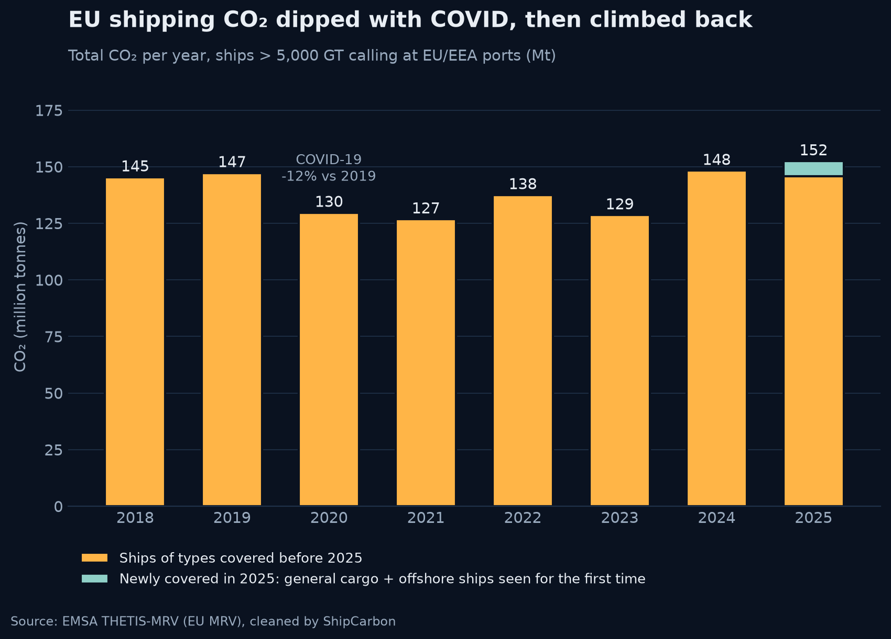
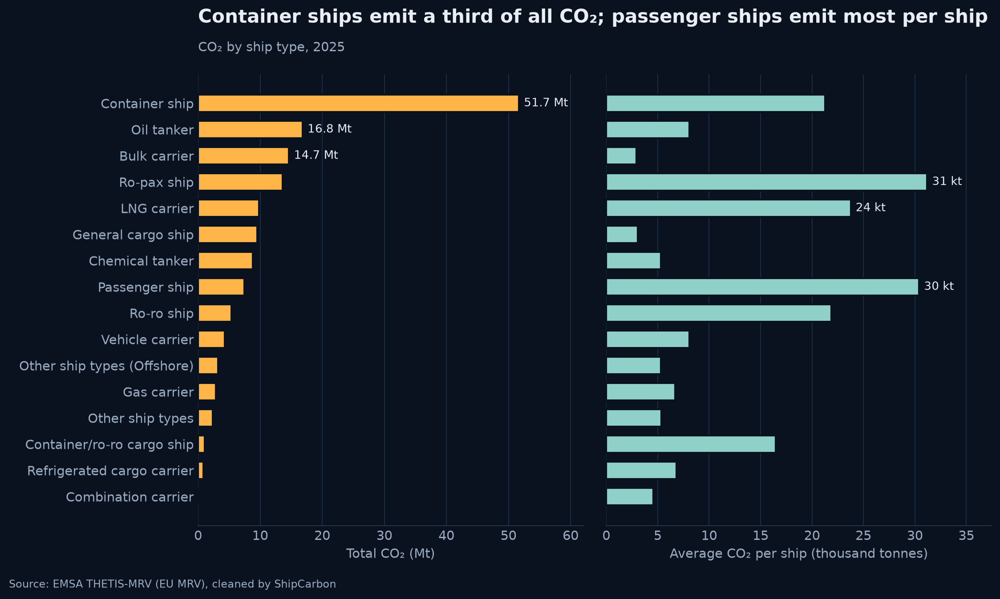
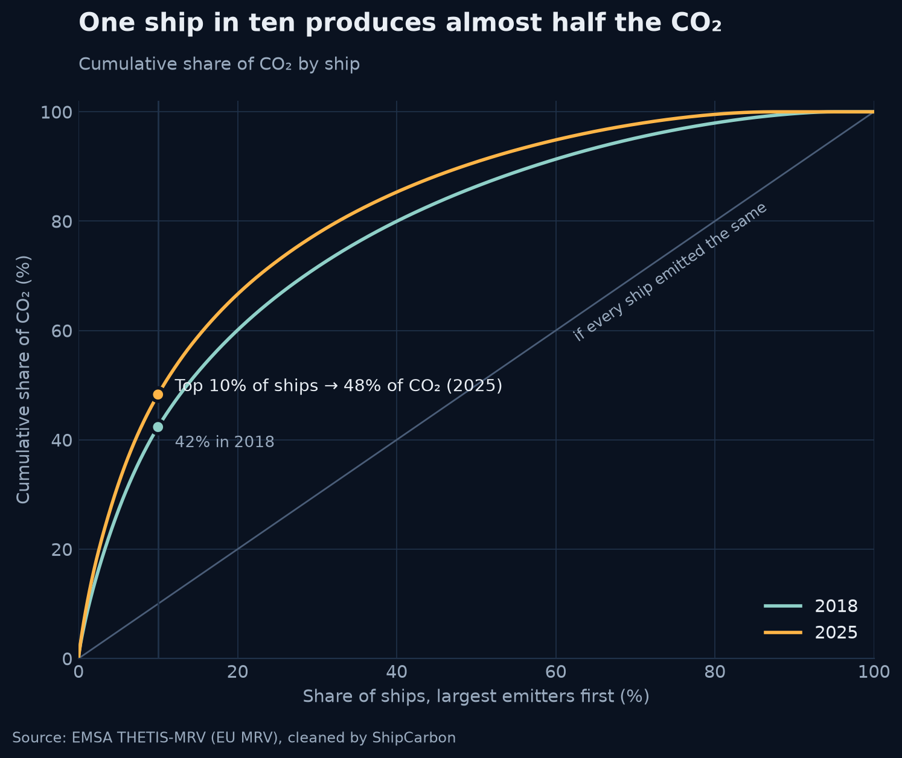
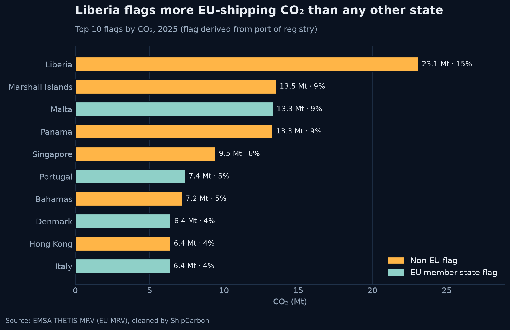
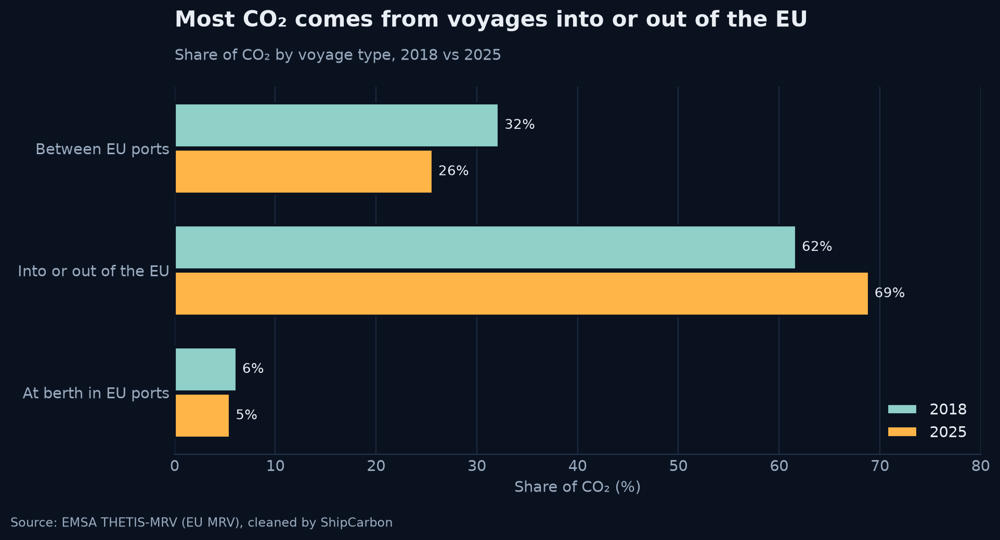
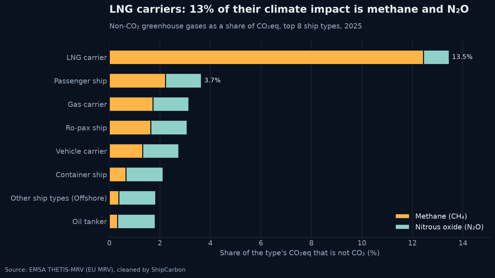
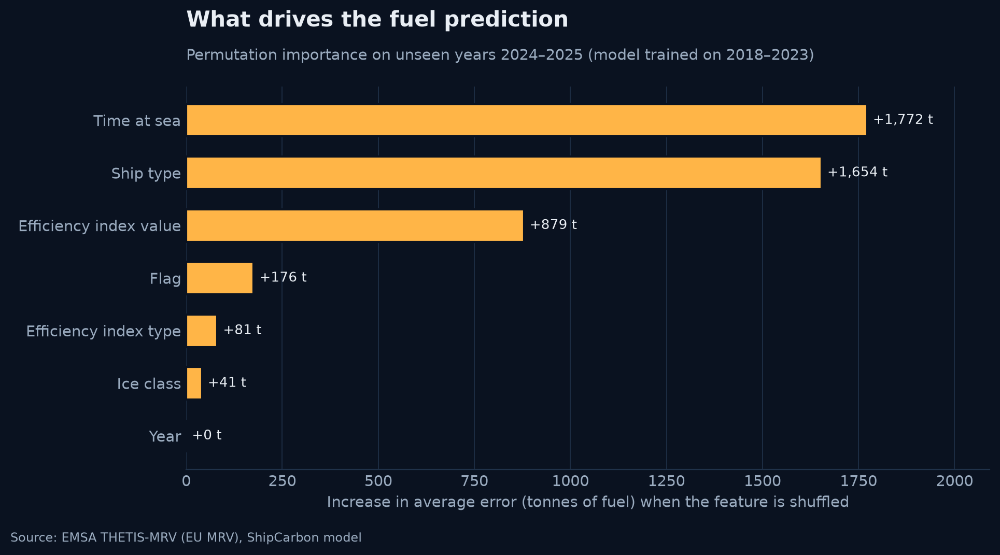

# ShipCarbon — Key insights

EU MRV data (EMSA THETIS-MRV), ships > 5,000 GT calling at EU/EEA ports, reporting years 2018–2025
(EMSA files downloaded 2026-10-15). One row per ship per year; partial reports are not double counted.
Every number comes from [`notebooks/01_eda.ipynb`](../notebooks/01_eda.ipynb); the cell numbers below count all
cells from the top (markdown and code).

---

### 1. COVID cut shipping CO₂ by 12% — and it took until 2024 to recover
**−12%** in 2020 (147 → 130 Mt). Emissions only passed the 2019 level again in 2024 (148 Mt).

*Source: notebook cell 5 (Q1).*

### 2. The 2025 increase comes from newly covered ships, not more emissions from existing ships
**+4.2 Mt** in 2025, but general cargo and offshore ships newly covered by the extended rules add **6.6 Mt**.
The 12,061 ships reported in both 2024 and 2025 emitted **6.3% less** (134.6 → 126.1 Mt).

*Source: notebook cell 5 (Q1).*

### 3. Container ships are 14% of the fleet but a third of the CO₂
**34%** of 2025 CO₂ (51.7 Mt) from 2,430 container ships. Ro-pax and passenger ships emit the most per ship
(~30 kt each, about 10× a bulk carrier).

*Source: notebook cell 8 (Q2).*

### 4. One ship in ten produces almost half the CO₂
The top 10% of ships emitted **48%** of CO₂ in 2025, up from 42% in 2018. The top 1% alone: 9.5%.

*Source: notebook cell 14 (Q4).*

### 5. Most CO₂ at EU ports comes from ships flagged outside the EU
Ships under an EU member-state flag emit only **37%** of the CO₂. Liberia alone flags 15% (23 Mt), and the top 10
flags carry 70%. *Flag is derived from the port of registry.*

*Source: notebook cell 11 (Q3).*

### 6. Voyages into and out of the EU dominate — and their share is growing
**69%** of CO₂ in 2025 comes from voyages arriving at or departing from EU ports (62% in 2018). Voyages between EU
ports fell from 32% to 26%; ships at berth add only 5–7%.

*Source: notebook cell 17 (Q5).*

### 7. LNG carriers: 2% of ships, ~60% of the methane
LNG carriers emitted **59%** of all reported methane in 2025 (50,500 t CH₄). Methane and N₂O add 13.5% to their
CO₂eq, versus about 2% for the rest of the fleet (EMSA's factors: CH₄ × 28, N₂O × 265).

*Source: notebook cell 23 (Q7).*

---

**Also in the notebook:** CO₂ per nautical mile by ship type (cell 20, `img/06_co2_per_nm.png`). Per-mile figures
mostly reflect ship size and speed, not cargo carried, so they are not used as a headline here.

**Caveats:** no ship size (DWT/GT) in the public data; flag is derived; 2025 covers more ship types than earlier
years; EMSA keeps correcting files (versions recorded in `data/raw/manifest.json`).

---

## Model: predicting a ship's annual fuel

**What it predicts:** how many tonnes of fuel a ship burns in a year on EU MRV voyages, from what we know about
the ship: type, efficiency index (type and value), hours at sea, ice class, flag (top 15, else "Other") and year.
CO₂ is then fuel × the median CO₂/fuel ratio of that ship type (about 3.14; 2.79 for LNG carriers). Nothing
computed from fuel (CO₂, CH₄, per-mile figures, distance) is used as an input, so the model cannot copy the answer.
Model: scikit-learn `HistGradientBoostingRegressor` on log(fuel); 101,428 ship-years from 25,249 ships.

**Results.** Baseline = median fuel per hour at sea for the ship type × the ship's hours at sea.

| Validation | Baseline average error | Model average error | Model median % error | Model R² |
|---|---|---|---|---|
| Ships the model never saw (GroupKFold by IMO) | 1,405 t | **755 t** (−46%) | 14.9% | 0.86 |
| Train 2018–2023, test 2024–2025 | 1,458 t | **736 t** (−50%) | 15.7% | 0.88 |

**What drives the prediction:** hours at sea and ship type matter most, then the efficiency index value. Flag, ice
class and efficiency-index type add a little; year adds nothing.

*Source: `python -m ml.train`, saved in `backend/app/model/metrics.json`.*

**Limitations**
- **No ship size.** The public data has no deadweight or gross tonnage, so a small and a very large ship of the
  same type look alike. This is the main source of error: offshore ships (53% median error), Ro-pax and passenger
  ships (24–27%) are the weakest types.
- **Flag is derived** from the port of registry, not reported directly; 2.4% of ship-years have an unknown
  flag.
- **2025 covers more ship types** (newly included general cargo and offshore ships), so 2025 is not like-for-like
  with earlier years.
